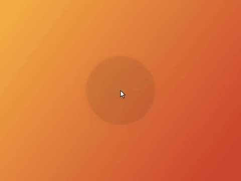
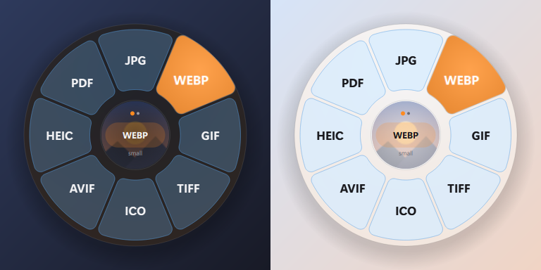
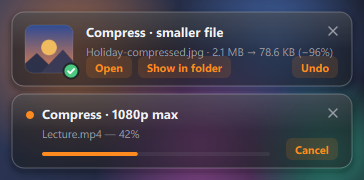
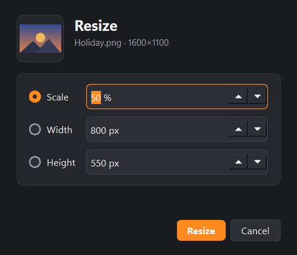
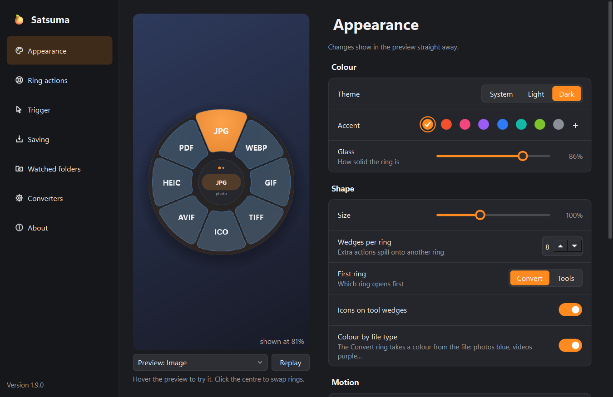
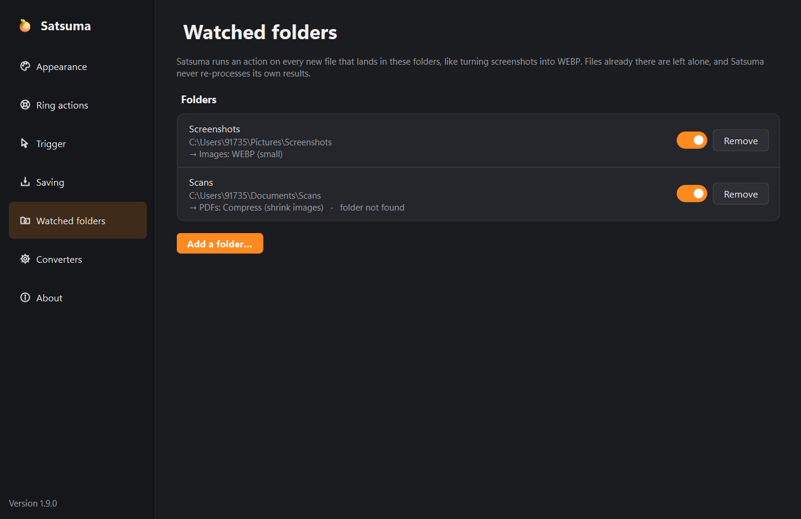

# Satsuma 🍊

**Hold Shift while dragging a file. A ring of actions springs open under your cursor. Drop the file on what you want.**

A Windows take on the drag-to-convert idea: convert, compress, trim, merge, lock and edit files
without opening a single app. Everything runs **locally on your PC** — files are never uploaded.



---

## Start it

1. Install **Python 3.10 or newer** from [python.org](https://www.python.org/downloads/)
   (tick **“Add python.exe to PATH”**).
2. Double-click **`run.bat`**.
   The first run sets things up (a minute or two); after that it starts instantly. When an update
   needs new packages, `run.bat` installs them by itself.
3. Satsuma lives in the system tray (the 🍊 by the clock).

Prefer a standalone `.exe`? See [Build an .exe](#build-an-exe).

## Use it



| Do this | What happens |
|---|---|
| Drag any file, and hold **Shift** while dragging | The ring springs open under your cursor, with a preview of the file in the centre |
| Move over a wedge | It lights up; a bubble beside it says what it will do and where the new file goes |
| Rest on the **centre** for a moment | The ring swaps between **Convert** and **Tools** (dots show which) — also right after the ring opens under your pointer |
| Drop the file on a wedge | A tick confirms it; the job runs in the background with a card in the corner |
| Let go anywhere else, or press **Esc** | Nothing happens |
| Right-click files → **Send to → Satsuma** | Same ring, click instead of drop *(enable in Settings)* |
| Click the tray icon | A drop window you can drag files onto without Shift (drag its centre to move it) |

**The cards in the corner**



- While a job runs: progress, and **Cancel** (a stopped video leaves no half-written file).
- When it's done: a preview of the result, how much smaller (or bigger) it got, **Open**,
  **Show in folder** and **Undo** (sends the new file to the Recycle Bin).
- **Drag a finished card** into WhatsApp, Discord, an email or a folder to share the result.
- The 🍊 in the tray shows a progress ring while anything runs, and a tick when it's all done.

**From the tray menu**

- **Convert clipboard** — copied files, or a copied picture (saved to `Pictures\Satsuma clipboard`).
- **Recent** — your last 10 results; click one to see it in its folder.
- **Undo** — the last conversion, even after its card has gone.

Your original file is **never changed, moved or deleted**. Results are saved next to it
(e.g. `photo.png` → `photo.webp`), and if that name is taken you get `photo (1).webp`.

> Shift normally means *move* when you drag in Explorer. Satsuma always takes the drop as a
> **copy**, so Explorer never removes the original.

## What it can do

| Files | Convert to | Tools |
|---|---|---|
| **Images** — PNG, JPG, WEBP, GIF, BMP, TIFF, ICO, HEIC, AVIF… | PNG · JPG · WEBP · GIF · TIFF · ICO · AVIF · HEIC · BMP · PDF | Compress · Resize · Rotate · Flip · **Clean** (removes location and camera details) · B&W · Square |
| **Videos** — MP4, MOV, MKV, WEBM, AVI… | MP4 · MOV · MKV · WEBM · AVI · GIF · MP3 | Compress · Trim · Mute · Frame grab · Speed (¼×–4×) · Rotate · Boomerang GIF · Join |
| **Audio** — MP3, WAV, M4A, FLAC, OGG, OPUS, AIFF… | MP3 · M4A · WAV · FLAC · OGG · OPUS · AIFF | Trim · Join |
| **PDF** | PNG · JPG (per page) · TXT | Merge · Compress · Split · Extract pages · Rotate · Page numbers · Lock / Unlock (password) |
| **Word** — DOCX, DOC, ODT, RTF | PDF · DOCX · DOC · RTF · ODT · TXT · HTML | |
| **Excel** — XLSX, XLS, ODS, CSV | PDF · XLSX · XLS · ODS · CSV · JSON (from CSV) | |
| **PowerPoint** — PPTX, PPT, ODP | PDF · PPTX · PPT · ODP | |
| **Text & web** — TXT, Markdown, HTML, JSON | PDF · HTML ⇄ Markdown · TXT · DOCX (from HTML) · JSON → CSV | |
| **Archives** — ZIP, 7Z, RAR, TAR, TAR.GZ, GZ… | | Extract |
| **Anything** | | ZIP |

Drop **several files** at once to batch them, or to **merge** (PDFs, images → one PDF) and
**join** (videos, audio) them. Merging and joining go in file-name order — `part1`, `part2`,
`part10` — so name them to set the order.

Actions that need a value ask in a small window first. **Compress** shows the file's current size and
lets you pick how small (Light, Balanced, Strong, Tiny, or anything in between), with a live estimate
and a warning when the setting is strong enough to make it hard to read. Resize, Trim, Pages, Lock and
Speed ask too:



### What it needs

- **Images, PDFs, text, data, archives** — nothing extra (7Z and RAR use the `tar` built into
  Windows 10 and 11).
- **Video & audio** — FFmpeg. Satsuma downloads it automatically the first time you use a
  video/audio action (a one-time 100–200 MB download, saved in `%LOCALAPPDATA%\Satsuma\bin`;
  if FFmpeg is already on your PATH it uses that instead). You can also press
  *Download FFmpeg* in Settings. That download is the only time Satsuma uses the internet.
- **Word / PowerPoint / Excel** — Microsoft Office, or [LibreOffice](https://www.libreoffice.org/)
  (free). Either one works for every Office conversion above; Office runs hidden in the
  background. Password-protected files are refused straight away with a clear message.

## Customise

Right-click the tray icon → **Settings…** It follows your theme and accent colour.



- **Appearance** — with a live preview you can hover and click: theme (Windows / light / dark),
  accent colour, how see-through the ring is, size, wedges per ring, which ring opens first,
  animation speed and bounce, what the centre shows, icons, a colour for the Convert ring by file type,
  and the explanation bubbles.
- **Ring actions** — for each kind of file, tick what appears in the ring and drag to reorder,
  with a live preview of that ring.
- **Trigger** — the key to hold (Shift / Ctrl / Alt), *only for real file drags*, start with
  Windows, *Send to* menu.
- **Saving** — where results go (next to the original, a subfolder, or one folder), with an
  example path; replace or add `(1)`; show in Explorer when done.
- **Watched folders** — run an action on every new file in a folder (say, Screenshots → WEBP).
  Files already there are left alone, and Satsuma never re-processes its own results.
- **Converters** — JPG/WEBP quality, compression strength, FFmpeg and Office/LibreOffice status.
- **About** — version, log, data folder, reset everything.



## Build an .exe

**On your PC:** double-click **`build.bat`** → `dist\Satsuma\Satsuma.exe`
(keep the whole `Satsuma` folder together).

**On GitHub (no setup):** put the workflow in `.github/workflows/build.yml` and push. It runs the
tests on Windows, builds the exe, starts it to check it works, and attaches
**Satsuma-windows.zip** to the run (Actions tab → latest run → Artifacts).

## Troubleshooting

- **Menu doesn't appear when dragging from an app running as Administrator.** Windows blocks
  drops from elevated apps into normal ones. Drag from regular Explorer windows, or run Satsuma
  as Administrator too.
- **Menu doesn't appear for files inside a .zip or from Outlook.** Those aren't real files on disk
  yet. Extract/save them first.
- **Shift-drag conflicts with another app.** Change the key in Settings → Trigger, or untick
  *Enabled* in the tray menu.
- **Windows SmartScreen warns about Satsuma.exe.** It's unsigned because it's your own build.
  Click *More info → Run anyway*.
- **Something failed?** The card says why. Full details: tray → **Open log**
  (`%LOCALAPPDATA%\Satsuma\satsuma.log`).

## Uninstall

Untick *Start when I sign in* and *Send to* in Settings, quit from the tray, then delete this
folder and `%LOCALAPPDATA%\Satsuma`.

## Project layout

```
main.py                   entry point
satsuma/app.py            tray, single instance, wiring
satsuma/detector.py       notices Shift-drags (polls GetAsyncKeyState, no hooks; slow when idle)
satsuma/actions.py        which actions show for which files
satsuma/jobs.py           background jobs, cancelling
satsuma/watcher.py        watched folders
satsuma/history.py        the tray's Recent list
satsuma/engine/           images · pdfs · media (FFmpeg) · documents (Qt, Office, LibreOffice) · archives
satsuma/ui/radial.py      the ring: geometry, hit-testing, drawing
satsuma/ui/menu.py        the overlay window (drag/drop, click and pinned modes)
satsuma/ui/toast.py       the result cards
satsuma/ui/settings_window.py, controls.py, prompts.py   Settings, its controls, the small dialogs
tests/                    pytest suite
tools/make_screenshots.py regenerates the pictures in docs/ from the app's own drawing code
```
