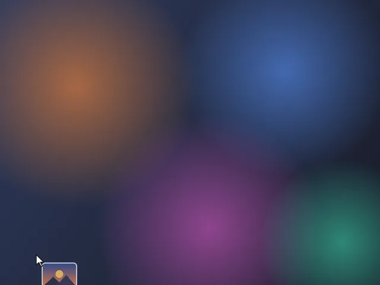
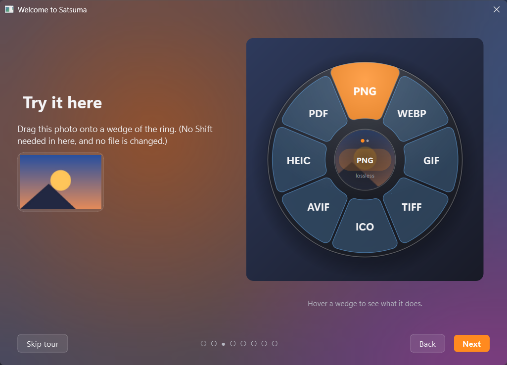

<div align="center">

# Satsuma 🍊

**Hold Shift while dragging a file. A ring of actions opens under your cursor. Drop the file on what you want.**

Convert, compress, trim, merge, rename and lock files on Windows, without opening a single app.
Everything runs **on your PC**: your files are never uploaded.

<a href="https://github.com/Elmozoop/Satsuma/releases/latest/download/Satsuma.exe"></a>

[](https://github.com/Elmozoop/Satsuma/releases/latest)
[](https://github.com/Elmozoop/Satsuma/releases)




[Get started](#get-started) · [What it can do](#what-it-can-do) · [Customise](#customise) · [Privacy](#privacy) · [FAQ](#faq) · [For developers](#for-developers)

</div>

---

## Why Satsuma

- **No app to open.** The tools come to the file you're already dragging: from Explorer, your desktop,
  a download bar, anywhere.
- **Nearly 90 conversions and tools.** Images, videos, audio, PDFs, Word, Excel, PowerPoint, text and
  archives, from one ring.
- **Your originals are safe.** Satsuma always makes a new file next to the old one, and every result
  has an **Undo**.
- **Private.** Every conversion happens on your PC. Nothing about your files is ever sent anywhere.
- **Light.** One file, no installer, waits quietly in the tray and keeps itself up to date.

## Get started

1. **[Download Satsuma.exe](https://github.com/Elmozoop/Satsuma/releases/latest/download/Satsuma.exe)**.
   That one file is all you need; the *Source code* files on the Releases page are for developers.
2. **Double-click it.** No installer, no Python. A one-minute **tour** opens, with a practice ring to try
   a drag without touching a real file.
3. When the tour ends, Satsuma asks whether it should **start with Windows**. Say yes and the ring is
   always ready.

Satsuma then waits in the system tray (the 🍊 by the clock). **Hold Shift while dragging any file** to
open the ring.

> [!TIP]
> Keep `Satsuma.exe` somewhere you can write to, such as Documents or a Tools folder (not Program
> Files), so it can update itself. Your settings live in `%LOCALAPPDATA%\Satsuma`, so moving the exe
> keeps them.

> [!NOTE]
> **Windows SmartScreen** may say it "protected your PC" the first time, because Satsuma.exe isn't
> signed with a paid certificate. Click **More info → Run anyway**.

### It keeps itself up to date

From 1.14 on, Satsuma checks GitHub for a new version a few times a day. When there is one, it
downloads it in the background, checks it against the SHA-256 fingerprint GitHub lists for it, and
installs it the next time you're not using Satsuma. A notification tells you when it's done, and your
settings stay as they were. *(On 1.13 or older? Download it once more; after that it updates by itself.)*

## How to use it


| Do this | What happens |
|---|---|
| Drag any file, and hold **Shift** while dragging | The ring opens under your cursor, with a preview of the file in the centre |
| Rest on a wedge for a moment | It lights up, and a panel beside it says what it will do and where the new file goes |
| Rest on the **centre** | The ring swaps between **Convert** and **Tools** (the dots show which) |
| Drop the file on a wedge | A tick confirms it; the job runs in the background with a card in the corner |
| Let go anywhere else, or press **Esc** | Nothing happens |
| Click the 🍊 in the tray | A drop window you can drag files onto without holding Shift |
| Right-click files → **Send to → Satsuma** | The same ring, click instead of drop *(switch on in Settings)* |

> Shift usually means *move* when you drag in Explorer. Satsuma always takes the drop as a **copy**,
> so Explorer never removes your original.

### Result cards


- **While a job runs:** progress, and **Cancel**. A stopped video leaves no half-written file.
- **When it's done:** a preview, how much smaller (or bigger) the file got, **Open**,
  **Show in folder** and **Undo** (sends the new file to the Recycle Bin).
- **Drag a finished card** straight into WhatsApp, Discord, an email or a folder to share the result.
- The 🍊 in the tray shows a progress ring while anything runs, and a tick when it's all done.

### The tray menu

Right-click the 🍊 for:
- **Convert clipboard:** copied files, or a copied picture (saved to `Pictures\Satsuma clipboard`).
- **Recent:** your last 10 results; click one to see it in its folder.
- **Undo:** the last conversion, even after its card has gone.
- **Enabled**, **Info panel beside wedges**, **Settings…**, **Tour…**, **Open log** and **Quit**.

Results are saved next to the original (`photo.png` → `photo.webp`). If that name is taken you get
`photo (1).webp`. The only action that changes your files is **Rename**, and its Undo puts the old
names back.

## What it can do

| Files | Convert to | Tools |
|---|---|---|
| **Images:** PNG, JPG, WEBP, GIF, BMP, TIFF, ICO, HEIC, AVIF… | PNG · JPG · WEBP · GIF · TIFF · ICO · AVIF · HEIC · BMP · PDF | Compress · Resize · Rotate · **Text** (copies the words in a picture, offline) · **Clean** (removes location and camera details) · B&W · Square · Flip |
| **Videos:** MP4, MOV, MKV, WEBM, AVI… | MP4 · MOV · MKV · WEBM · AVI · GIF · MP3 | Compress · Trim · Mute · Frame grab · Speed (¼×–4×) · **Level** (evens out the volume) · Boomerang GIF · Rotate · Join |
| **Audio:** MP3, WAV, M4A, FLAC, OGG, OPUS, AIFF… | MP3 · M4A · WAV · FLAC · OGG · OPUS · AIFF | Trim · **Level** · Join |
| **PDF** | PNG · JPG (one per page) · TXT | Merge · Compress · Split · Extract pages · Rotate · Page numbers · Lock / Unlock (password) |
| **Word:** DOCX, DOC, ODT, RTF | PDF · DOCX · DOC · RTF · ODT · TXT · HTML | |
| **Excel:** XLSX, XLS, ODS, CSV | PDF · XLSX · XLS · ODS · CSV · JSON (from CSV) | |
| **PowerPoint:** PPTX, PPT, ODP | PDF · PPTX · PPT · ODP | |
| **Text & web:** TXT, Markdown, HTML, JSON | PDF · HTML ⇄ Markdown · TXT · DOCX (from HTML) · JSON → CSV | |
| **Archives:** ZIP, 7Z, RAR, TAR, TAR.GZ, GZ… | | Extract |
| **Anything** | | ZIP · **Rename** several files at once (`Trip 01`, `Trip 02`…), with a preview |

**Several files at once?** Drop them together to convert them all, to **merge** them (PDFs, or images
into one PDF) or to **join** them (videos, audio). Merging and joining go in file-name order (`part1`,
`part2`, `part10`), so name them to set the order.

**Actions that need a value ask first**, in a small window. **Compress** shows the file's current size
and lets you choose how small (Light, Balanced, Strong, Tiny, or anything in between), with a live
estimate and a warning when it's strong enough to make the file hard to read. Resize, Trim, Pages,
Lock and Speed ask too.


### What each kind of file needs

| Files | Needs |
|---|---|
| Images, PDFs, text, data, archives | Nothing extra. 7Z and RAR use the `tar` built into Windows 10 and 11. |
| Video and audio | **FFmpeg**, which Satsuma downloads by itself the first time you use a video or audio action (a one-time 100–200 MB download). If FFmpeg is already installed, it uses that. |
| Word, Excel, PowerPoint | **Microsoft Office** or the free **[LibreOffice](https://www.libreoffice.org/)**. Either one handles every Office conversion, hidden in the background. |

## Customise

Right-click the 🍊 → **Settings…** Satsuma follows your Windows theme and accent colour.

**Glass or Solid.** **Glass** (the default) makes every surface frosted and see-through: Settings,
prompts and menus use Windows' own acrylic blur, and the ring, cards and info panel blur whatever is
behind them. **Solid** keeps them plain. Switch in **Appearance → Style**.


| Section | What you can change |
|---|---|
| **Appearance** | Style, theme, accent colour, how see-through the ring is, size, wedges per ring, which ring opens first, animation speed and bounce, what the centre shows, icons, colours by file type, the info panel. All with a live preview you can hover and click. |
| **Ring actions** | For each kind of file, **click a wedge in the preview** to swap in another action or take it off the ring. Or tick and drag in the list. |
| **Trigger** | The key to hold (Shift, Ctrl or Alt), *only for real file drags*, start with Windows, the *Send to* menu. |
| **Saving** | Where results go (next to the original, a subfolder, or one folder), replace or add `(1)`, show in Explorer when done. |
| **Watched folders** | Run an action on every new file in a folder, such as Screenshots → WEBP. Files already there are left alone. |
| **Converters** | JPG/WEBP quality, compression strength, FFmpeg and Office/LibreOffice status. |
| **About** | Version, automatic updates, the user count, the tour, log, data folder, reset everything. |


### Take the tour again

A short guided tour runs the first time Satsuma starts, with a practice ring to try a drag on. Replay
it any time from the 🍊 menu → **Tour…**



## Privacy

**Your files never leave your PC.** Every conversion runs locally, and nothing about your files, their
names or what you do with them is ever sent anywhere.

Satsuma goes online for three things only:

| What | When | Turn it off |
|---|---|---|
| **FFmpeg** download | Once, the first time you use a video or audio action | Don't use video/audio actions, or install FFmpeg yourself |
| **Update check** (Satsuma.exe only) | A few times a day: asks GitHub whether there's a newer release | Settings → About → **Update automatically** |
| **Anonymous "I'm running" signal** | Every 10 minutes: a random ID made on your PC (not linked to you) and the Satsuma version, so the author can see how many people use it | Settings → About → **Count me as an active user** (also on the tour's last page) |

## FAQ

<details>
<summary><b>Is Satsuma.exe safe? Why does Windows warn about it?</b></summary>

Signing an app costs money every year, so Satsuma.exe isn't signed, and SmartScreen warns about any
unsigned download it hasn't seen often. The full source code is in this repository, and every
release is built from it. Click **More info → Run anyway**.
</details>

<details>
<summary><b>The ring doesn't open when I drag.</b></summary>

- Check **Enabled** is ticked in the 🍊 menu, and that you're holding the right key (Settings → Trigger).
- Dragging from an app running **as Administrator**? Windows blocks drops from elevated apps into
  normal ones. Drag from a normal Explorer window, or run Satsuma as Administrator too.
- Files **inside a .zip or an Outlook email** aren't real files yet. Extract or save them first.
</details>

<details>
<summary><b>Shift-drag clashes with another app.</b></summary>

Change the key to Ctrl or Alt in **Settings → Trigger**, or untick **Enabled** in the 🍊 menu while
you use that app.
</details>

<details>
<summary><b>It isn't updating itself.</b></summary>

Updates need Satsuma.exe in a folder you can write to. Move it out of Program Files into Documents or
a Tools folder. Also check **Settings → About → Update automatically** is on. Running from source? Use
`git pull` instead.
</details>

<details>
<summary><b>Does it work on Windows 10?</b></summary>

Yes, Windows 10 and 11 (64-bit). The Glass style looks best on Windows 11, which has the newer
acrylic blur.
</details>

<details>
<summary><b>Something failed. Where can I see why?</b></summary>

The card in the corner says why. For full details, open the 🍊 menu → **Open log**
(`%LOCALAPPDATA%\Satsuma\satsuma.log`).
</details>

<details>
<summary><b>How do I uninstall it?</b></summary>

In Settings, untick **Start when I sign in** and **Send to**. Quit from the 🍊 menu, then delete
`Satsuma.exe` and the folder `%LOCALAPPDATA%\Satsuma`.
</details>

## For developers

<details>
<summary><b>Run from source</b></summary>

1. Install **Python 3.10 or newer** from [python.org](https://www.python.org/downloads/) (tick
   **"Add python.exe to PATH"**).
2. Double-click **`run.bat`**. The first run sets things up (a minute or two); after that it starts at
   once, and installs new packages by itself when an update needs them.
</details>

<details>
<summary><b>Build Satsuma.exe</b></summary>

Double-click **`build.bat`** → `dist\Satsuma.exe`. What goes into the exe is in
[`satsuma-exe.spec`](satsuma-exe.spec), which leaves out the parts of Qt Satsuma doesn't use so the exe
starts faster. The build then runs `Satsuma.exe --self-test`, which exercises every engine inside the
exe (images, HEIC/AVIF, PDF rendering and passwords, text recognition, archives, the tour…) and stops
if anything is missing.

**To release:** upload `dist\Satsuma.exe` to a GitHub release tagged with a higher version
(`v1.16.0`), named exactly `Satsuma.exe`, as a normal release (not a pre-release). Every copy from 1.14
on picks it up by itself.
</details>

<details>
<summary><b>Tests</b></summary>

```
.venv\Scripts\python.exe -m pytest
```

The tests run offscreen and never touch your settings, your real files or the user counter.
</details>

<details>
<summary><b>The user counter</b></summary>

A tiny Cloudflare Worker in [`server/`](server/) counts active copies. See
[`server/README.md`](server/README.md) for setting up your own.
</details>

<details>
<summary><b>Project layout</b></summary>

```
main.py                     entry point
satsuma/app.py              tray, single instance, wiring
satsuma/detector.py         notices Shift-drags (polls the keyboard; no hooks, slow when idle)
satsuma/actions.py          which actions show for which files
satsuma/jobs.py             background jobs, cancelling
satsuma/watcher.py          watched folders
satsuma/history.py          the tray's Recent list
satsuma/updater.py          self-update from GitHub Releases
satsuma/telemetry.py        the anonymous "I'm running" signal
satsuma/selftest.py         the exe's --self-test
satsuma/engine/             images · pdfs · media (FFmpeg) · documents (Qt, Office, LibreOffice) · archives
satsuma/ui/radial.py        the ring: geometry, hit-testing, drawing
satsuma/ui/menu.py          the overlay window (drag/drop, click and pinned modes)
satsuma/ui/toast.py         the result cards
satsuma/ui/glass.py         the Glass style: acrylic and blurred backdrops
satsuma/ui/tutorial.py      the first-run tour
satsuma/ui/settings_window.py, controls.py, prompts.py   Settings, its controls, the small dialogs
satsuma/ui/stats_window.py  the author's Stats window
server/                     the user counter (Cloudflare Worker + D1)
tests/                      pytest suite
tools/make_screenshots.py   regenerates the pictures in docs/ from the app's own drawing code
satsuma-exe.spec, build.bat how Satsuma.exe is built
```
</details>
